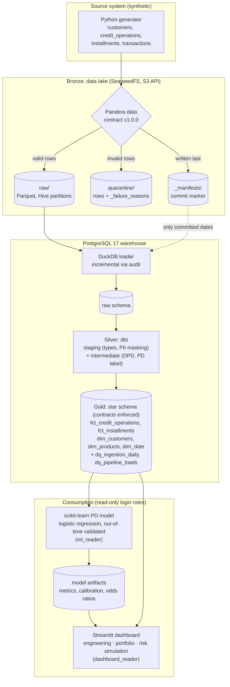
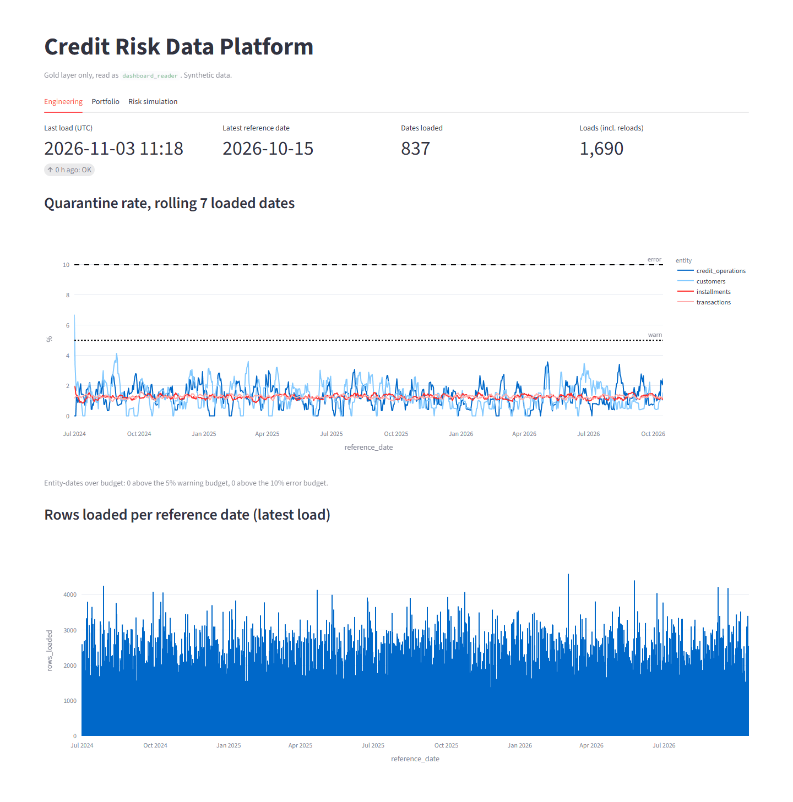
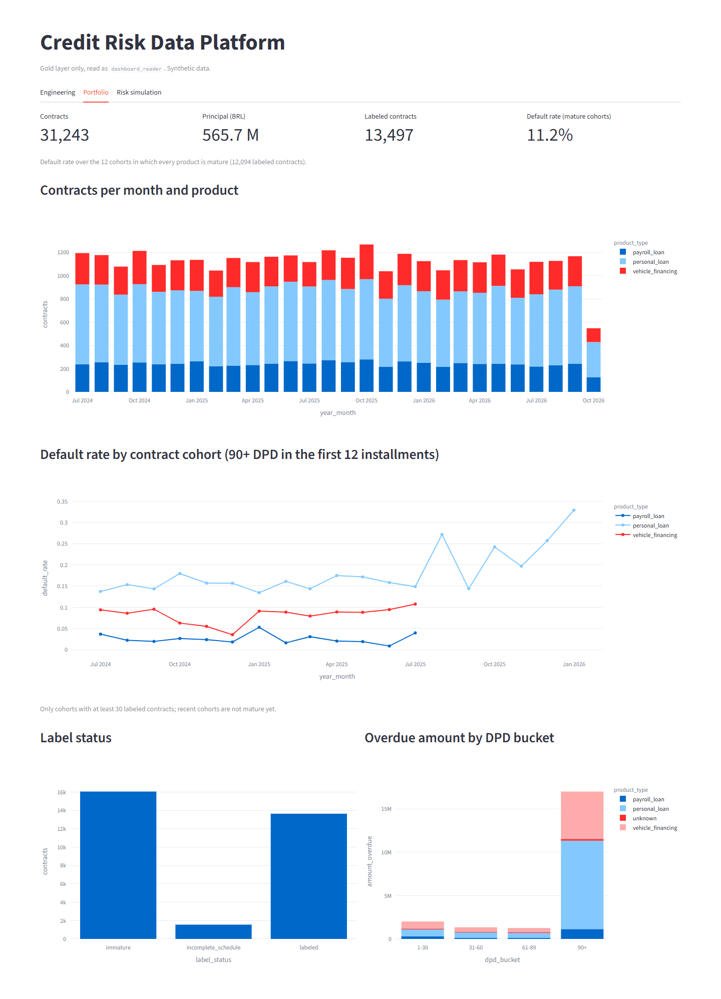
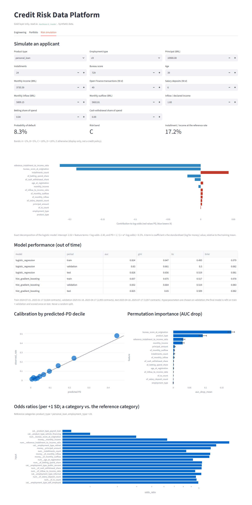

# Credit Risk Data Platform

[](https://github.com/leoh-coder/credit-risk-data-platform/actions/workflows/ci.yml)

A retail lender that grants credit automatically needs each customer's cadastral, financial,
payment and transactional data in one place, checked and on time, to estimate a probability of
default (PD) per application. This repository builds that path on synthetic data: daily batches
land in an S3-compatible lake behind data contracts, a loader moves them into PostgreSQL, dbt
builds a tested star schema, and a PD model and a Streamlit dashboard read the result. Everything
runs locally with Docker Compose.



## Dashboard



Engineering: time since the last load, the rolling 7-date quarantine rate per entity against its budget, and rows loaded per date.



Portfolio: contracts by month and product, default rate by cohort, label status and overdue amount by days-past-due bucket.



Risk simulation: the PD of an applicant typed into fields generated from the feature list, its exact per-feature log-odds decomposition, then out-of-time metrics, calibration, permutation importance and odds ratios.

## Scope

Default is 90+ days past due within the first 12 installments. Only mature contracts get a label.

| Domain | Source system | Signals |
|---|---|---|
| Cadastral | Onboarding / KYC | income, employment type, state, age |
| Financial | Loan origination | product, principal, rate, term, bureau score |
| Payment behavior | Loan servicing | installments due vs. paid, days past due |
| Transactional | Open Finance history | salary deposits, PIX, betting spend, cash withdrawals |

## How it works

### Ingestion (`ingestion/`)

A generator produces customers, credit operations, installments and pre-application Open Finance
transactions for three products (`personal_loan`, `payroll_loan`, `vehicle_financing`). Output is
deterministic per `(seed, reference_date, as_of)`. A latent risk factor drives both the features
and default and is never exported. Payments after `as_of` are not observed.

Pandera contracts at the lake boundary decide what happens to bad data:

| Violation | Example | Action |
|---|---|---|
| Schema level | missing, extra or renamed column | Batch rejected (`strict=True`; drift requires a new contract version) |
| Row level | negative amount, unknown state, future transaction | Row quarantined with `_failure_reasons` |
| Duplicated key | same `transaction_id` twice | First occurrence kept, repeats quarantined |
| Error budget | > 10% of an entity's rows and > 5 rows invalid | Batch rejected |

Valid rows land as Hive-partitioned Parquet under `raw/<entity>/reference_date=YYYY-MM-DD/` and
invalid rows under `quarantine/`. A manifest, written last, commits the date; every row carries its
batch, reference date, extraction time and generator version.

### Loader (`loader/`)

A DuckDB job loads only committed dates whose manifest changed since the last load recorded in
`audit.lake_loads`. Each date is one Postgres transaction that reconciles row counts with the
manifest; any failure rolls the date back and leaves it pending. A manifest must list exactly the
four known entities, so no other name reaches SQL.

### Warehouse (`dbt/credit_risk/`)

dbt builds one schema per layer. Staging sets exact types and masks PII (the CPF becomes a salted
SHA-256, e-mail and phone keep only domain and area code, the name is dropped). Intermediate
computes days past due, the PD label and pre-application Open Finance features. The marts are a
star schema (`fct_credit_operations`, `fct_installments`, `dim_customers`, `dim_products`,
`dim_date`) plus `dq_ingestion_daily` and `dq_pipeline_loads` for pipeline health.

The label is measured against the extraction clock, never `current_date`, and a window with a
quarantined installment is never labeled, so gaps cannot over-represent defaults. Orphans from
row-level quarantine point to a `'-1'` unknown member, so facts reconcile with `raw`.

`dbt build` runs 124 nodes with 0 warnings on the full history: enforced contracts on every mart,
domain and key tests, singular tests that reconcile lake, `raw` and facts, a PII scan over the
marts, source freshness on `_loaded_at`, and 5 unit tests (DPD and censoring, maturity boundaries,
quarantine window, reference-rate affordability, overdue amount). Three data-quality budgets
(unknown customer, incomplete label window, quarantine rate) warn before they fail; their
thresholds are in [docs/DECISIONS.md](docs/DECISIONS.md), and only they keep failing rows in `audit`.

Access is granted per layer, and the grants are the protection: `analytics_reader` has SELECT on
`marts` only, and the login roles `ml_reader` and `dashboard_reader` inherit only that role. Their
sessions also default to read-only, an extra guard that a session can turn off. The model and
dashboard containers never receive the admin credentials, and a test fails if a dashboard query
reads anything outside `marts`.

### Model (`ml/`)

The population comes from the marts: labeled contracts of known customers, up to the last contract
date that is mature for every product. That date comes from the observation clock (observation -
90 days - 12 months = 2025-07-17) and leaves 12,614 contracts with 1,412 defaults (11.2%).

The features are an allowlist of 15 columns known at the grant date; tests forbid outcome, key and
lineage columns. Nothing that embeds the bank's own price is a feature: affordability enters as the
installment at a fixed 3% monthly reference rate over income, not at the contract rate.

The main model is a logistic regression with explicit reference categories (`personal_loan`,
`clt`); a regularized HistGradientBoosting is the comparison. `python -m ml.train` writes the
model, `metrics.json`, calibration, coefficients, permutation importance, simulation defaults
and a model card.

## Model results

The split is out of time, with 3-month validation and test periods (both are parameters).
Hyperparameters and permutation importance use the validation period only; the chosen models are
refit on train + validation and scored once on the test period.

| Period | Contracts | Defaults |
|---|---|---|
| Train: 2024-07-01 to 2025-01-17 | 6,664 | 720 |
| Validation: 2025-01-18 to 2025-04-17 | 2,893 | 337 |
| Test: 2025-04-18 to 2025-07-17 | 3,057 | 355 |

| Model | Train AUC | Validation AUC | Test AUC | Test Gini | Test KS | Test Brier | Test mean PD vs. observed |
|---|---|---|---|---|---|---|---|
| Logistic regression (C = 1.0) | 0.824 | 0.830 | 0.828 | 0.656 | 0.519 | 0.0813 | 0.110 vs. 0.116 |
| HistGradientBoosting (depth 2, leaf 200) | 0.837 | 0.832 | 0.825 | 0.650 | 0.509 | 0.0823 | 0.110 vs. 0.116 |

On the test period the largest gap between predicted and observed default rate across PD deciles
is 0.036 for the logistic model and 0.044 for the boosting model. The logistic model stays the main
one: slightly better discrimination and calibration, and an exact explanation per applicant.

## Running locally

Requirements: Docker with Compose v2. Python 3.12 is needed only for local tests, and `make` is
optional (the equivalent `docker compose` command is shown next to each target).

```bash
cp .env.example .env                              # then change the secrets
make up                                           # docker compose up -d --wait
make backfill                                     # 2024-07-01..2026-10-15, as of 2026-10-15
make load                                         # docker compose run --rm --build loader run
make transform                                    # docker compose run --rm --build dbt build
make train                                        # docker compose run --rm --build ml
make dashboard                                    # docker compose --profile app up --build dashboard
```

Every port is bound to 127.0.0.1. The dashboard is at http://127.0.0.1:8501, dbt docs
(`make docs`) at http://127.0.0.1:8080, the SeaweedFS filer at http://127.0.0.1:8888/buckets/ with
the S3 API on port 8333, and PostgreSQL at `127.0.0.1:5432`, database `credit_risk_dw`.

The full backfill (837 dates, 30 customers a day) takes about 40 minutes on an HDD; a short range
is enough for everything except training. `make load` is incremental (a second run reports
`0 loaded, N already up to date`). `make down` keeps the data; `make clean` deletes the volumes.
`make help` lists the other targets.

Without Docker, `STORAGE_BACKEND=local` writes the lake to `./data/lake`:

```bash
PYTHONPATH=ingestion/src python -m ingestion.main backfill --start 2026-01-01 --end 2026-01-02 --as-of 2026-10-15
```

Against SeaweedFS outside Docker, set `AWS_ACCESS_KEY_ID` / `AWS_SECRET_ACCESS_KEY` (Compose
translates `LAKE_ACCESS_KEY` / `LAKE_SECRET_KEY` only for the containers). `.env.example` lists
the other optional settings.

## Tests and CI

```bash
pip install -r ingestion/requirements-dev.txt -r loader/requirements-dev.txt \
            -r ml/requirements-dev.txt -r dashboard/requirements-dev.txt
make test lint
```

pytest runs 28 tests in `ingestion` (including the S3 path against moto), 23 in `loader` (real
Postgres, a throwaway database per test; skipped locally without Postgres, never in CI), 73 in
`ml` and 34 in `dashboard` (including the whole app run headless with `AppTest`). CI runs ruff and
pytest per package, then a Compose smoke run: a 3-day backfill, load, incremental no-op,
`dbt build`, freshness, the docs artifact, grants and login roles, the ML population query as
`ml_reader`, every dashboard query as `dashboard_reader`, and the dashboard health check. The model
is not trained in CI, because 3 days have no contract old enough to train on.

## Limitations

- The data is synthetic.
- The warehouse SQL still contains Postgres-specific constructs (see [docs/PORTABILITY.md](docs/PORTABILITY.md)).
- Vehicle financing PD is under-predicted on the most recent test cohorts.

## Further reading

Technical decisions and their reasons: [docs/DECISIONS.md](docs/DECISIONS.md). Postgres-specific
SQL and its Redshift equivalents: [docs/PORTABILITY.md](docs/PORTABILITY.md).

## Project structure

```
.
├── docker-compose.yml   # lake, warehouse, jobs (profile "jobs"), dashboard (profile "app"), docs
├── Makefile
├── infra/postgres/      # schemas per layer, read-only and login roles
├── ingestion/           # generator, contracts, lake writer, CLI
├── loader/              # committed lake dates -> Postgres raw, audited
├── dbt/credit_risk/     # staging, intermediate, marts, tests
├── ml/                  # feature allowlist, out-of-time split, models, explainability
├── dashboard/           # Streamlit app
└── docs/                # DECISIONS.md, PORTABILITY.md, dashboard screenshots
```

## Tech stack

Python 3.12 · pandas · NumPy · Faker · Pandera · PyArrow · Pydantic Settings · SeaweedFS ·
DuckDB · PostgreSQL 17 · dbt (dbt-postgres, dbt_utils) · scikit-learn · Streamlit · Plotly ·
Docker Compose · pytest · moto · ruff · GitHub Actions
