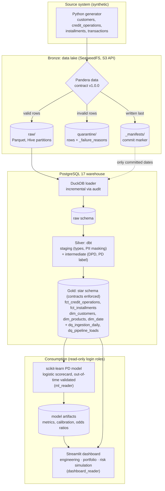

# Credit Risk Data Platform

Batch data platform for retail credit risk. A synthetic core-banking source lands daily batches
in an S3-compatible lake behind data contracts, a DuckDB loader moves committed dates into
PostgreSQL, dbt builds a tested star schema, and a probability-of-default (PD) model and a
Streamlit dashboard consume the Gold layer. Everything runs locally with Docker Compose.



## Scope

Default is defined as **90+ days past due within the first 12 installments**, labeled on mature
contracts only.

| Domain | Source system | Signals |
|---|---|---|
| Cadastral | Onboarding / KYC | income, employment type, state, age |
| Financial | Loan origination | product, principal, rate, term, bureau score |
| Payment behavior | Loan servicing | installments due vs. paid, days past due |
| Transactional | Open Finance history | salary deposits, PIX, betting spend, cash withdrawals |

## Components

### Ingestion (`ingestion/`)

- Deterministic generator per `(seed, reference_date, as_of)`: customers, credit operations,
  installments and pre-application Open Finance transactions for three products
  (`personal_loan`, `payroll_loan`, `vehicle_financing`). A latent risk factor drives both the
  features and default and is never exported. Payments after `as_of` are not observed.
- Pandera contracts at the lake boundary:

  | Violation | Example | Action |
  |---|---|---|
  | Schema level | missing, extra or renamed column | Batch rejected (`strict=True`; drift requires a new contract version) |
  | Row level | negative amount, unknown state, future transaction | Row quarantined with `_failure_reasons` |
  | Duplicated key | same `transaction_id` twice | First occurrence kept, repeats quarantined |
  | Error budget | > 10% of an entity's rows **and** > 5 rows invalid | Batch rejected |

- Hive-partitioned Parquet (zstd):

  ```
  s3://credit-risk-lake/
    raw/<entity>/reference_date=YYYY-MM-DD/part-0.parquet
    quarantine/<entity>/reference_date=YYYY-MM-DD/part-0.parquet
    _manifests/reference_date=YYYY-MM-DD/manifest.json
  ```

  Each run replaces its own partitions. The manifest is the commit marker: deleted first (only
  after validation passes, so a rejected rerun keeps the previous commit) and written last. It
  records row counts, contract and generator versions, and run duration.
- Lineage columns on every row: `_batch_id`, `_reference_date`, `_extracted_at`,
  `_generator_version`.

### Loader (`loader/`)

- Loads committed dates only. A date is (re)loaded when the SHA-256 of its manifest differs from
  the last entry in `audit.lake_loads`.
- One Postgres transaction per date through DuckDB's `postgres` extension: delete the date,
  `INSERT ... BY NAME`, reconcile counts with the manifest, re-check the manifest, write the
  audit row, commit. Any failure rolls the date back and leaves it pending.
- Raw tables are created from the Parquet schema and indexed on `_reference_date`. Entity names
  read from the lake are allow-listed before they reach SQL.

### Warehouse (`dbt/credit_risk/`)

| Layer | Models | Purpose |
|---|---|---|
| Staging (views) | `stg_core_banking__*`, `stg_open_finance__transactions` | Exact types, renaming, observation clock, PII masking |
| Intermediate (views) | `int_installments__delinquency`, `int_credit_operations__performance`, `int_customers__open_finance_features` | Days past due, PD label with censoring rules, pre-application features |
| Marts (tables) | `fct_credit_operations`, `fct_installments`, `dim_customers`, `dim_products`, `dim_date`, `dq_ingestion_daily`, `dq_pipeline_loads` | Star schema and data-quality marts |

- PII is masked in staging: CPF becomes a salted SHA-256, e-mail its domain, phone its area
  code, and the name is dropped.
- The PD label is measured against the extraction clock, never `current_date`.
  `label_status` is `labeled`, `immature` or `incomplete_schedule`. A gap in the window can
  confirm an observed default but never a good outcome.
- Orphans from row-level quarantine point to a `'-1'` unknown member, so facts reconcile with
  `raw`.
- Data quality (`dbt build`: 128 nodes, 0 warnings on the full history):
  - enforced model contracts on every mart;
  - domains, ranges, row invariants and composite keys;
  - singular tests reconciling lake → `raw` → facts, checking schedules against contracts, and
    rejecting post-application Open Finance data;
  - a PII scan over every text column of the marts;
  - budgets with warn and error levels:

    | Budget | Warn | Error |
    |---|---|---|
    | Unknown customer | 2% | 5% |
    | Incomplete label window | 15% | 30% |
    | Quarantine per entity, rolling 7 loaded dates | 5% | 10% |
  - failing rows stored in `audit`, source freshness on `_loaded_at`, and 3 dbt unit tests
    (DPD and censoring branches, maturity boundaries, rolling quarantine window).

### PD model (`ml/`)

- Population: marts only, labeled contracts of known customers, contracts up to 2025-07-17
  (the last date with every product mature). That leaves 12,774 contracts and 1,572 defaults.
- Out-of-time split: train on 2024-07-01 to 2025-03-31 (9,155 contracts), test on 2025-04-01 to
  2025-07-17 (3,619 contracts).
- A feature allowlist of 16 columns known at the grant date. Outcome, key and lineage columns
  are forbidden, and tests enforce it. The population query is generated from the allowlist.
  Excluded on purpose: the interest rate (pricing feedback loop), and the e-mail domain, phone
  area code and state (proxies).
- Main model: logistic regression in a scikit-learn `Pipeline`. Comparison model: regularized
  HistGradientBoosting.

  | Model | Train AUC | Test AUC | Test Gini | Test KS | Test Brier | Test mean PD vs. observed |
  |---|---|---|---|---|---|---|
  | Logistic regression | 0.826 | 0.821 | 0.643 | 0.498 | 0.0882 | 0.123 vs. 0.128 |
  | HistGradientBoosting | 0.852 | 0.822 | 0.643 | 0.496 | 0.0891 | 0.122 vs. 0.128 |

  The largest gap between predicted and observed default rate across PD deciles is 0.032 for
  the logistic model and 0.041 for the boosting model. Vehicle financing is under-predicted on
  the test period (0.077 vs. 0.101).
- Explainability: odds ratios, permutation importance (out of time), and exact per-feature
  log-odds contributions per applicant.
- `python -m ml.train` writes the model, `metrics.json`, calibration, coefficients, permutation
  importance, simulation defaults and a model card.

### Dashboard (`dashboard/`)

Streamlit with three tabs:
- **Engineering:** freshness, rolling quarantine rate against the budget, loads per date.
- **Portfolio:** volume by month and product, default rate by cohort, label status, overdue
  amount by DPD bucket.
- **Risk simulation:** PD, a display-only band, per-feature contributions, and model metrics,
  calibration, importance and odds ratios.

### Access control

One schema per layer. `analytics_reader` reads `marts` only. `ml_reader` and `dashboard_reader`
are login roles that inherit only `analytics_reader` and run read-only sessions. Their
containers never receive the admin credentials, and the dashboard's queries are tested to read
`marts` only.

## Design decisions

See [docs/DECISIONS.md](docs/DECISIONS.md).

## Portability notes

The warehouse targets PostgreSQL 17, and the project is **not** fully portable. Where a dbt or
`dbt_utils` macro exists, the models use it:
- `dbt_utils.date_spine` instead of `generate_series`;
- `dbt.dateadd` instead of `make_interval`;
- `SUM(CASE WHEN ...)` instead of `FILTER (WHERE ...)`;
- `ROW_NUMBER() OVER (...)` instead of `DISTINCT ON`.

What is still Postgres-specific, and the usual Amazon Redshift equivalent:

| Postgres construct | Where | Redshift equivalent |
|---|---|---|
| `jsonb`, `->>`, `jsonb_each` with `CROSS JOIN LATERAL` | `audit.lake_loads.manifest_entities`, `dq_ingestion_daily`, `assert_raw_matches_latest_lake_load` | A `SUPER` column navigated with PartiQL, and unnesting/unpivoting of the object instead of `jsonb_each` |
| `sha256()` + `convert_to()` + `encode(..., 'hex')` | `stg_core_banking__customers` (CPF hash) | `SHA2(expr, 256)` |
| `age()` with `date_part('year', ...)` | `dim_customers` (age at registration) | `DATEDIFF(year, ...)` plus a birthday adjustment (no `AGE`) |
| `extract(isodow ...)` | `dim_date` | `DATE_PART(dow, ...)` (Sunday = 0), remapped to ISO |
| Regex class `\D` in `regexp_replace` | `stg_core_banking__customers` | An explicit class such as `[^0-9]` |
| Enforced `PRIMARY KEY` from dbt contracts | every mart | Redshift enforces `NOT NULL` only; primary keys are informational, so the dbt `unique` tests remain the real guard |
| `DO $$ ... $$` block, `NOLOGIN` role | `infra/postgres/init.sql` | No anonymous blocks: plain `CREATE ROLE` / groups and a stored procedure if needed |
| psql meta-commands (`\getenv`, `\gexec`, `\if`) | `infra/postgres/roles.sql` | Plain `CREATE USER ... PASSWORD` and `GRANT ROLE` run by the deployment tool |
| Loading through DuckDB's `postgres` extension (wire protocol) | `loader/` | `COPY` from the Parquet files already in S3; row inserts do not scale on Redshift |

These were reviewed by reading the code, not by running on Redshift. A real port would
start by running `dbt build` against a Redshift target.

## Running locally

Requirements: Docker with Compose v2. Python 3.12 is needed only for local tests, and `make` is
optional (the equivalent `docker compose` command is shown next to each target).

```bash
cp .env.example .env                              # then change the secrets
make up                                           # docker compose up -d --wait
CUSTOMERS_PER_BATCH=30 make backfill START=2024-07-01 END=2026-10-15 AS_OF=2026-10-15
make load                                         # docker compose run --rm --build loader run
make transform                                    # docker compose run --rm --build dbt build
make train                                        # docker compose run --rm --build ml
make dashboard                                    # docker compose --profile app up --build dashboard
```

| Service | Address |
|---|---|
| Dashboard | http://localhost:8501 |
| dbt docs (`make docs`) | http://localhost:8080 |
| SeaweedFS S3 API | `http://localhost:8333` |
| SeaweedFS filer UI | http://localhost:8888/buckets/ |
| PostgreSQL | `localhost:5432`, database `credit_risk_dw` |

The full backfill takes about 40 minutes on an HDD. A short range (for example a week) is
enough for everything except training, because the model needs mature cohorts.

- `make backfill` without `CUSTOMERS_PER_BATCH` uses the `.env` value (150).
- `make load` is incremental: a second run reports `0 loaded, N already up to date`.
- `make freshness` checks the freshness of `raw`.
- `make roles` adds the login roles to a volume created before they existed.
- `make down` stops the containers and keeps the data; `make clean` deletes the volumes.
- Without Docker, `STORAGE_BACKEND=local` writes the lake to `./data/lake`:

  ```bash
  PYTHONPATH=ingestion/src python -m ingestion.main backfill --start 2026-01-01 --end 2026-01-02 --as-of 2026-10-15
  ```

## Tests

```bash
pip install -r ingestion/requirements-dev.txt -r loader/requirements-dev.txt \
            -r ml/requirements-dev.txt -r dashboard/requirements-dev.txt
make test lint
```

| Package | Tests | Notes |
|---|---|---|
| `ingestion` | 26 | Includes the S3 code path against a moto emulator |
| `loader` | 15 | Real Postgres, with a throwaway database per test (skipped locally if unreachable; fails in CI) |
| `ml` | 50 | Allowlist and leakage, split limits, metrics on hand-computed cases, exact contributions, artifacts |
| `dashboard` | 24 | Marts-only queries, scoring, and the whole app run headless with `AppTest` |
| dbt | 128 nodes | Run by `make transform` |

CI (GitHub Actions) runs ruff and pytest per package. A compose smoke run then covers a 3-day
backfill, load, incremental no-op, `dbt build`, freshness, the docs artifact, grants and login
roles, every dashboard query as `dashboard_reader`, and the dashboard health check. The model is
not trained in CI, because a short backfill has no mature cohort.

## Limitations

- The data is synthetic.
- The warehouse SQL still contains Postgres-specific constructs (see the portability notes).
- Vehicle financing PD is under-predicted on the most recent test cohorts.

## Project structure

```
.
├── docker-compose.yml   # lake, warehouse, jobs (profile "jobs"), dashboard (profile "app")
├── Makefile
├── infra/postgres/      # schemas per layer, read-only and login roles
├── ingestion/           # generator, contracts, lake writer, CLI
├── loader/              # committed lake dates -> Postgres raw, audited
├── dbt/credit_risk/     # staging, intermediate, marts, tests
├── ml/                  # feature allowlist, out-of-time split, models, explainability
├── dashboard/           # Streamlit app
└── docs/DECISIONS.md    # technical decisions
```

## Tech stack

Python 3.12 · pandas · NumPy · Faker · Pandera · PyArrow · Pydantic Settings · SeaweedFS ·
DuckDB · PostgreSQL 17 · dbt (dbt-postgres, dbt_utils) · scikit-learn · Streamlit · Plotly ·
Docker Compose · pytest · moto · ruff · GitHub Actions
